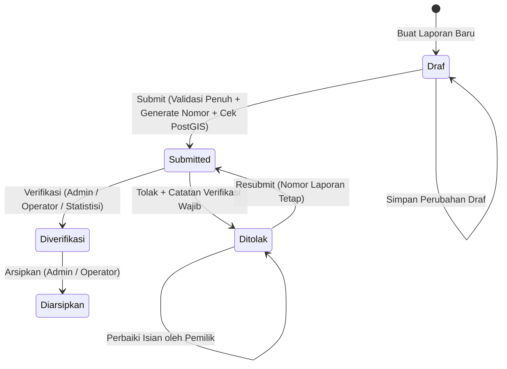

# JAGAPADI v3 — Product Requirements Document (PRD)

> **Status:** DISETUJUI (Baseline Fase 0–5)
> **Tanggal:** 2026-11-03
> **Proyek:** `new-jagapadi-3509` (JAGAPADI v3 — Kabupaten Jember `3509`)
> **Dokumen Terkait:** [BLUEPRINT.md](BLUEPRINT.md) · [ROADMAP.md](ROADMAP.md) · [GAP-CHECK-2026-11-02.md](GAP-CHECK-2026-11-02.md)

---

## 1. Tujuan & Cakupan Produk

**JAGAPADI (Jember Agrikultur Gapai Prestasi Digital)** adalah platform pelaporan lapangan, verifikasi berjenjang, dan analitik geospasial pertanian untuk Kabupaten Jember (`3509`).

Versi 3 (v3) menyatukan dua runtime lama dan aplikasi mobile Flutter menjadi **satu aplikasi Web & PWA mobile-first** berbasis **Laravel 11 (PHP 8.3)**, **React 19 + TypeScript**, **PostgreSQL 16 + PostGIS**, dan **Redis 7**.

---

## 2. Keputusan Modul Legacy (Resolusi Gap-Check §2)

Untuk mencegah *scope creep* dan *breaking change* tersembunyi, berikut keputusan resmi atas modul sistem lama:

| # | Modul / Fitur Sistem Lama | Keputusan di v3 | Alasan & Tindak Lanjut |
|---|---|---|---|
| 2.1 | **6 Domain Laporan Utama** (`hama`, `irigasi`, `pupuk`, `panen`, `cuaca`, `alat-sarana`) | **DIPERTAHANKAN (Inti)** | Disatukan di bawah tabel induk `reports` (*Class Table Inheritance*). Fase 2: Hama & Irigasi; Fase 4: Pupuk, Panen, Cuaca, Alat & Sarana. |
| 2.2 | **Domain `laporan-lainnya` & `master_jenis_laporan`** | **DIHENTIKAN (Drop)** | Di DB lama hanya berisi 1 baris uji; sub-jenisnya (panen, alsintan, kerusakan cuaca, bibit) sudah tercakup secara terstruktur di 6 domain utama v3. |
| 2.3 | **Integrasi `/api/external/*` & `honor_pelaporan` (SIMITRA)** | **DITANGGUHKAN (Opsional Fase 4+)** | Tidak masuk jalur kritis Fase 1–3. Jika SIMITRA masih membutuhkan sinkronisasi kegiatan/honor, diimplementasikan sebagai modul terpisah ber-middleware `X-API-Key` di Fase 4. |
| 2.4 | **API Publik `/api/v1/bps/*`** | **DIUBAH KE INTERNAL** | Tidak dibuka sebagai API publik bebas; digantikan oleh endpoint analitik terautentikasi (`/api/v1/analytics/bps` & `/api/v1/analytics/ksa`) dan *queue scraper* internal. |
| 2.5 | **Storytelling / Qwen AI (`/api/qwen/*`)** | **DIGANTI DETERMINISTIK** | Ketergantungan ke API LLM berbayar eksternal dihentikan. Digantikan ringkasan analitik berbasis aturan (*rule-based narrative*: deviasi estimasi vs rilis BPS & korelasi *lag-1* curah hujan/hama) di Fase 3. |
| 2.6 | **Modul Feedback (`feedback`, `vote`)** | **DIHENTIKAN (Drop)** | Fokus aplikasi pada operasional pertanian; pelaporan kendala teknis aplikasi dilakukan melalui kanal operasional admin/helpdesk. |
| 2.7 | **Soft Delete vs Hard Delete (`recycle-bin`)** | **SOFT DELETE + AUDIT LOG** | Tabel `reports`, `users`, dan master utama menggunakan `SoftDeletes` (`deleted_at`, `deleted_by`) + pencatatan wajib di `activity_log`. Tanpa UI *recycle bin* terpisah; hanya Admin yang dapat melihat/memulihkan data terhapus. |
| 2.8 | **Import User Massal** | **SEEDER + FORM ADMIN** | ~52 pengguna aktif dapat dikelola melalui seeder awal dan CRUD Admin (tanpa modul upload CSV user yang kompleks di Fase 1). |

---

## 3. Peran Pengguna & Matriks Hak Akses (RBAC 5 Role)

Sistem menggunakan `spatie/laravel-permission` dengan **5 role eksplisit**. Kepemilikan data (*ownership*) selalu diambil dari sesi pengguna yang terautentikasi (`auth()->id()`), **tidak pernah** dari input client.

### 3.1 Definisi 5 Role

1. **`admin` (Administrator Sistem):** Pemilik penuh sistem; mengelola pengguna, master wilayah, master OPT, memverifikasi/menolak/mengarsipkan laporan seluruh kabupaten, memantau *queue*/scraper, dan melihat audit log.
2. **`operator` (Operator Data Kabupaten):** Pengelola operasional harian; memverifikasi/menolak laporan petugas yang masuk (`Submitted`), mengelola master OPT & usulan OPT, serta mengimpor/memperbarui data pendukung (KSA, BPS, harga, iklim). Tidak mengelola akun pengguna atau konfigurasi sistem.
3. **`statistisi` (Analis & Verifikator Statistik):** Konsumen analitik & penjaga kualitas data; memiliki akses baca global ke seluruh laporan resmi (`Submitted` & `Diverifikasi`), dashboard, peta PostGIS, evaluasi akurasi panen, **hak verifikasi kualitas laporan**, serta **ekspor data penuh (XLSX/CSV/PDF)**.
4. **`petugas` (Petugas/Mitra Pengumpul Data Lapangan):** Ujung tombak pelaporan di lahan. Pada praktiknya role ini **diisi oleh mitra statistik BPS Kabupaten Jember** dan — sesuai rencana — oleh **PPL (Penyuluh Pertanian Lapangan) / petugas pengolah data tingkat kecamatan di Dinas TPHP Kabupaten Jember**. Membuat draf laporan (online maupun offline PWA), mengambil titik GPS & foto lapangan, mengirim (`submit`) dan memperbaiki laporan miliknya yang ditolak (`resubmit`), mengajukan usulan OPT baru, serta melihat dashboard/peta/riwayat **khusus laporan miliknya sendiri**.
5. **`viewer` (Pimpinan / Eksekutif):** Konsumen informasi baca-saja (*read-only*); memantau KPI dashboard tingkat kabupaten/kecamatan/desa, peta sebaran interaktif, tren KSA/BPS/harga/iklim, dan mengunduh laporan ekspor resmi.

### 3.2 Matriks Permission per Modul

Keterangan:
* **G** = Global (seluruh Kabupaten Jember)
* **O** = Own (hanya data milik sendiri: `reports.user_id = auth.id`)
* **R** = Read · **C** = Create · **U** = Update · **D** = Soft Delete
* **—** = Ditolak (`403 Forbidden`)

| Modul / Aksi | Permission Key | `admin` | `operator` | `statistisi` | `petugas` | `viewer` |
|---|---|---|---|---|---|---|
| **Auth & Profil Sendiri** (`login`, `logout`, `me`, `change-password`) | *(authenticated)* | Ya | Ya | Ya | Ya | Ya |
| **Manajemen Pengguna** (CRUD user, toggle aktif, reset password admin) | `users.manage` | **G (CRUD)** | — | — | — | — |
| **Audit Log Sistem** (`activity_log`) | `audit.view` | **G (R)** | — | — | — | — |
| **Master Wilayah** (Lihat pohon wilayah & poligon peta) | `regions.view` | **G (R)** | **G (R)** | **G (R)** | **G (R)** | **G (R)** |
| **Master Wilayah** (Ubah atribut/geometri/impor batas) | `regions.manage` | **G (CRUD)** | — | — | — | — |
| **Master OPT** (Lihat daftar OPT aktif & acuan ETL) | `opts.view` | **G (R)** | **G (R)** | **G (R)** | **G (R)** | **G (R)** |
| **Master OPT** (Tambah/ubah/nonaktifkan OPT) | `opts.manage` | **G (CRUD)** | **G (CRU)** | — | — | — |
| **Usulan OPT Baru** (Ajukan usulan + foto dari lapangan) | `opt-proposals.create` | **G (C)** | **G (C)** | — | **O (CR)** | — |
| **Usulan OPT Baru** (Setujui/tolak usulan → masuk Master OPT) | `opt-proposals.review` | **G (RU)** | **G (RU)** | — | — | — |
| **Laporan — Buat & Simpan Draf** | `reports.create` | **G (C)** | **G (C)** | — | **O (C)** | — |
| **Laporan — Lihat Daftar & Detail** | `reports.view` | **G (Semua Status)** | **G (Non-Draf + Draf Sendiri)** | **G (`Submitted`, `Diverifikasi`, `Diarsipkan`)** | **O (Semua Status Miliknya)** | **G (`Submitted`, `Diverifikasi`)** |
| **Laporan — Edit (`Draf` atau `Ditolak`)** | `reports.update` | **G (U)** | — | — | **O (U — hanya `Draf`/`Ditolak`)** | — |
| **Laporan — Submit / Resubmit** (`Draf`/`Ditolak` → `Submitted`) | `reports.submit` | **G** | **G (Miliknya)** | — | **O (Miliknya)** | — |
| **Laporan — Verifikasi / Tolak** (`Submitted` → `Diverifikasi`/`Ditolak`) | `reports.verify` | **G** | **G** | **G** | — | — |
| **Laporan — Arsipkan** (`Diverifikasi` → `Diarsipkan`) | `reports.archive` | **G** | **G** | — | — | — |
| **Laporan — Hapus (Soft Delete)** | `reports.delete` | **G (Semua)** | — | — | **O (Hanya `Draf` miliknya)** | — |
| **Dashboard & Peta Sebaran** | `dashboard.view` | **G** (+ opsi `include_draft`) | **G** (Resmi) | **G** (Resmi) | **O** (Scoped miliknya + opsi `include_draft`) | **G** (Resmi) |
| **Data Referensi (KSA, BPS, Harga, Iklim)** — Lihat | `reference-data.view` | **G (R)** | **G (R)** | **G (R)** | **G (R)** | **G (R)** |
| **Data Referensi (KSA, BPS, Harga, Iklim)** — Impor/Input/Scraper | `reference-data.manage` | **G (CRUD)** | **G (CRU)** | **G (CRU)** | — | — |
| **Ekspor Data (XLSX, CSV, PDF)** | `exports.generate` | **G** | **G** | **G** | **O (Miliknya)** | **G** |

---

## 4. Siklus Hidup Laporan & Penomoran Otomatis

### 4.1 Mesin Status Laporan (`ReportStatus`)

### 4.2 Aturan Bisnis Transisi Status

1. **Nilai Enum Resmi di DB & API:** `Draf`, `Submitted`, `Diverifikasi`, `Ditolak`, `Diarsipkan` (UI menampilkan label `Dikirim` untuk `Submitted`).
2. **Validasi Dua Tingkat:**
   - Saat menyimpan **`Draf`**: sebagian kolom detail boleh kosong agar petugas dapat menyimpan temuan awal.
   - Saat transisi ke **`Submitted`**: **seluruh kolom wajib domain harus terisi dan lolos validasi server**.
3. **Larangan Bypass Status:**
   - Laporan berstatus `Draf` **tidak boleh** langsung diubah menjadi `Diverifikasi` atau `Ditolak` (`422 Unprocessable Entity`).
   - Laporan yang sudah `Submitted`, `Diverifikasi`, atau `Diarsipkan` **dikunci dari pengeditan petugas** (hanya laporan `Draf` atau `Ditolak` yang bisa diedit pemiliknya).
   - Penolakan (`Ditolak`) **wajib** menyertakan `verification_notes` (minimal 5 karakter).
4. **Kebijakan Statistik & Agregat Default:**
   - Seluruh perhitungan KPI, grafik tren, peta sebaran, dan ekspor secara default **hanya menyertakan status `Submitted` dan `Diverifikasi`** (mengecualikan `Draf`, `Ditolak`, dan `Diarsipkan`).
   - Parameter opsional `include_draft=true` hanya diizinkan untuk `admin` (global) dan `petugas` (khusus laporan miliknya sendiri).

### 4.3 Format Nomor Laporan Atomic (`report_number_counters`)

Nomor laporan dibangkitkan secara atomik (`SELECT ... FOR UPDATE` / `INSERT ... ON CONFLICT DO UPDATE` pada tabel `report_number_counters`) **hanya saat laporan pertama kali bertransisi ke `Submitted`**.
* Saat laporan `Ditolak` dikirim ulang (`resubmit`), **nomor laporan yang sudah ada dipertahankan**.
* Format: **`{PREFIX}-{YYYYMMDD}-{NNNN}`** (4 digit urutan harian dengan *zero-padding*, dihitung berdasarkan tanggal kejadian/submit per tipe laporan):

| Tipe Laporan (`report_type`) | Prefix | Contoh Nomor Laporan | Fase Implementasi |
|---|---|---|---|
| `pest` (Hama / OPT) | `LH` | `LH-20261103-0001` | Fase 2 |
| `irrigation` (Irigasi) | `LI` | `LI-20261103-0001` | Fase 2 |
| `fertilizer` (Pupuk) | `LP` | `LP-20261103-0001` | Fase 4 |
| `harvest` (Panen) | `LPA` | `LPA-20261103-0001` | Fase 4 |
| `weather` (Cuaca Lapangan) | `LC` | `LC-20261103-0001` | Fase 4 |
| `equipment` (Alat & Sarana) | `LAS` | `LAS-20261103-0001` | Fase 4 |

---

## 5. Spesifikasi Skema & Validasi 6 Domain Laporan

### 5.1 Tabel Induk: `reports` (Semua Domain)

Semua 6 domain laporan berbagi kolom dasar pada tabel `reports`:

| Nama Kolom (v3) | Padanan Legacy | Tipe Data | Wajib Draf? | Wajib Submit? | Aturan Validasi & Keterangan |
|---|---|---|---|---|---|
| `id` | `id` | `bigserial` | Auto | Auto | Primary Key |
| `client_uuid` | — *(Baru v3)* | `uuid` (unique, nullable) | Opsional | Ya (PWA) | UUID untuk sinkronisasi offline idempoten |
| `report_number` | `nomor_laporan` | `varchar(30)` (unique, nullable) | Tidak (`NULL`) | Auto-generated | Dibuat saat pertama kali `Submitted` |
| `report_type` | *(implisit per tabel)* | `varchar(20)` | **Ya** | **Ya** | `pest`, `irrigation`, `fertilizer`, `harvest`, `weather`, `equipment` |
| `user_id` | `user_id` | `bigint` (FK `users`) | Auto | Auto | Diambil dari sesi login (`auth()->id()`) |
| `status` | `status` | `varchar(20)` | Auto (`Draf`) | `Submitted` | `Draf`, `Submitted`, `Diverifikasi`, `Ditolak`, `Diarsipkan` |
| `report_date` | `tanggal` | `date` | **Ya** | **Ya** | Tanggal observasi di lahan; `<= hari ini` (`Asia/Jakarta`) |
| `regency_id` | `kabupaten_id` | `bigint` (FK `regencies`) | **Ya** | **Ya** | Default Kabupaten Jember (`3509`) |
| `district_id` | `kecamatan_id` | `bigint` (FK `districts`) | **Ya** | **Ya** | Harus milik `regency_id` yang dipilih |
| `village_id` | `desa_id` | `bigint` (FK `villages`) | Opsional | **Ya** | Harus milik `district_id` yang dipilih |
| `location_name` | `lokasi` | `varchar(255)` | Opsional | Opsional | Nama blok/dusun/poktan singkat |
| `address_detail` | `alamat_lengkap` | `varchar(300)` | Opsional | Opsional | Patokan lokasi yang mudah dikenali |
| `latitude` | `latitude` | `numeric(10,7)` | Berpasangan | **Ya** | Rentang Jember: `-8.6000000` s.d. `-7.8000000` (selalu negatif) |
| `longitude` | `longitude` | `numeric(10,7)` | Berpasangan | **Ya** | Rentang Jember: `113.2000000` s.d. `114.1000000` (selalu positif) |
| `geom` | — *(Baru PostGIS)* | `geometry(Point, 4326)` | Auto | Auto | Dihitung otomatis: `ST_SetSRID(ST_MakePoint(longitude, latitude), 4326)` |
| `is_coordinate_mismatch` | — *(Baru PostGIS)* | `boolean` (default `false`) | Auto | Auto | `true` jika titik GPS berada di luar poligon desa/kecamatan pilihan |
| `notes` | `catatan` | `text` | Opsional | Opsional | Maksimal 5.000 karakter |
| `verified_by` | `verified_by` | `bigint` (FK `users`, nullable) | — | — | Diisi otomatis saat verifikasi/tolak |
| `verified_at` | `verified_at` | `timestamptz` (nullable) | — | — | Waktu keputusan verifikasi/tolak |
| `verification_notes` | `catatan_verifikasi` | `text` (nullable) | — | Wajib saat `Ditolak` | Alasan penolakan atau catatan verifikator |
| `submitted_ip` | `ip_pengirim` | `inet` / `varchar(45)` | Auto | Auto | IP pengirim untuk jejak audit |
| `deleted_at`, `deleted_by` | `deleted_at`, `deleted_by` | `timestamptz`, `bigint` | — | — | Soft delete |

> **Lampiran Media (`report_photos` & `report_videos`):**
> * Saat `Submitted`, laporan **Hama (`pest`)** dan **Irigasi (`irrigation`)** wajib memiliki minimal **1 foto bukti lapangan** (`report_photos`).
> * Maksimal 5 foto per laporan; ukuran unggah maks 5 MB per foto setelah kompresi klien; server memvalidasi magic bytes + MIME (`image/jpeg`, `image/png`, `image/webp`) dan mengonversi ulang ke **WebP** (maks lebar `1280px`, kualitas `80`).

---

### 5.2 Detail Domain 1: Laporan Hama / OPT (`report_pest_details`) — *Fase 2*

| Nama Kolom (v3) | Padanan Legacy | Tipe Data | Satuan | Wajib Submit? | Aturan Validasi & Bisnis |
|---|---|---|---|---|---|
| `report_id` | — | `bigint` (PK & FK `reports.id`) | — | Auto | Relasi 1:1 ke `reports` |
| `opt_id` | `master_opt_id` | `bigint` (FK `opts.id`) | — | **Ya** (kecuali ada `opt_proposal_id`) | Harus mengacu pada OPT berstatus `aktif = true` |
| `opt_proposal_id` | `usulan_opt_id` | `bigint` (FK `opt_proposals.id`, nullable) | — | Opsional | Dipakai bila OPT baru sedang diusulkan |
| `severity_level` | `tingkat_keparahan` | `varchar(20)` | Kategori | **Ya** | Nilai: `Ringan`, `Sedang`, `Berat` |
| `measurement_method` | `metode_pengukuran` | `varchar(20)` | Kategori | **Ya** | Nilai: `absolut` atau `persentase` (default `absolut`) |
| `population_intensity` | `populasi` | `numeric(10,2)` | Sesuai `opts.etl_unit` (`ekor/rumpun`, `%`, dll.) | **Ya** | `>= 0`. Dibandingkan otomatis dengan `opts.etl_threshold` untuk flag `is_above_etl` |
| `affected_area_ha` | `luas_serangan` | `numeric(10,2)` | Hektar (`Ha`) | **Ya** | `> 0` dan `<= 9999.99`. Jika `observed_area_ha` diisi, `affected_area_ha <= observed_area_ha` |
| `observed_area_ha` | `luas_areal_diamati` | `numeric(10,2)` | Hektar (`Ha`) | Opsional | `>= affected_area_ha` (luas hamparan yang diamati) |
| `alert_area_ha` | `luas_serangan_estimasi` | `numeric(10,2)` | Hektar (`Ha`) | Opsional | Luas keadaan waspada/terancam di sekitar titik serangan (`>= 0`) |
| `attack_percentage` | `persentase_serangan` | `numeric(5,2)` | Persen (`%`) | Opsional | `0` s.d. `100` |
| `commodity_variety` | *(di catatan lama)* | `varchar(100)` | Teks | Opsional | Varietas tanaman (mis. Ciherang, Inpari 32) |
| `plant_age_hst` | *(di catatan lama)* | `smallint` | Hari Setelah Tanam (`HST`) | Opsional | `1` s.d. `150` HST |
| `is_above_etl` | *(dihitung)* | `boolean` | Flag | Auto | `true` bila `opts.etl_threshold IS NOT NULL` dan `population_intensity >= opts.etl_threshold` |

---

### 5.3 Detail Domain 2: Laporan Irigasi (`report_irrigation_details`) — *Fase 2*

| Nama Kolom (v3) | Padanan Legacy | Tipe Data | Satuan | Wajib Submit? | Aturan Validasi & Bisnis |
|---|---|---|---|---|---|
| `report_id` | — | `bigint` (PK & FK `reports.id`) | — | Auto | Relasi 1:1 ke `reports` |
| `channel_name` | `nama_saluran` | `varchar(200)` | Teks | **Ya** | Minimal 3 karakter (contoh: `Saluran Primer Bondoyudo`) |
| `irrigation_area_name` | `daerah_irigasi` | `varchar(200)` | Teks | Opsional | Nama Daerah Irigasi (DI) / Bendung |
| `channel_type` | `jenis_saluran` | `varchar(20)` | Kategori | **Ya** | Nilai: `Primer`, `Sekunder`, `Tersier` |
| `physical_condition` | `kondisi_fisik` | `varchar(20)` | Kategori | **Ya** | Nilai: `Bagus`, `Sedang`, `Tidak Bagus`, `Rusak` |
| `water_discharge_status` | `debit_air` | `varchar(20)` | Kategori | **Ya** | Nilai: `Cukup`, `Kurang`, `Kering` |
| `service_area_ha` | `luas_layanan` | `numeric(12,2)` | Hektar (`Ha`) | Opsional | `>= 0` (luas sawah terdampak/dilayani) |
| `repair_status` | `status_perbaikan` | `varchar(30)` | Kategori | **Ya** | Nilai: `Normal`, `Belum Ditangani`, `Dalam Perbaikan`, `Selesai Diperbaiki` |
| `action_taken` | `aksi_dilakukan` | `text` | Teks | Opsional | Tindakan darurat/penanganan awal di lapangan |

---

### 5.4 Detail Domain 3: Laporan Pupuk (`report_fertilizer_details`) — *Fase 4*

| Nama Kolom (v3) | Padanan Legacy | Tipe Data | Satuan | Wajib Submit? | Aturan Validasi & Bisnis |
|---|---|---|---|---|---|
| `report_id` | — | `bigint` (PK & FK `reports.id`) | — | Auto | Relasi 1:1 ke `reports` |
| `fertilizer_type` | `jenis_pupuk` | `varchar(100)` | Teks/Kategori | **Ya** | Contoh: `Urea`, `NPK Phonska`, `ZA`, `Organik` |
| `dosage_amount` | `dosis` | `numeric(10,2)` | Angka | **Ya** | `> 0` |
| `dosage_unit` | `satuan_dosis` | `varchar(50)` | Satuan | **Ya** | Nilai standar: `kg/ha`, `liter/ha`, `kuintal/ha`, `kg` |
| `application_method` | `metode_aplikasi` | `varchar(100)` | Teks/Kategori | Opsional | Contoh: `Tebar`, `Kocor`, `Semprot`, `Benam` |
| `related_opt_id` | `master_opt_id` | `bigint` (FK `opts.id`, nullable) | — | Opsional | Jika pemupukan terkait pemulihan serangan OPT |

---

### 5.5 Detail Domain 4: Laporan Panen (`report_harvest_details`) — *Fase 4*

| Nama Kolom (v3) | Padanan Legacy | Tipe Data | Satuan | Wajib Submit? | Aturan Validasi & Bisnis |
|---|---|---|---|---|---|
| `report_id` | — | `bigint` (PK & FK `reports.id`) | — | Auto | Relasi 1:1 ke `reports` |
| `commodity` | `komoditas` | `varchar(150)` | Teks/Kategori | **Ya** | Contoh: `Padi`, `Jagung`, `Kedelai` |
| `variety` | `varietas` | `varchar(100)` | Teks | Opsional | Varietas tanaman yang dipanen |
| `harvest_area_ha` | `luas_panen` | `numeric(10,2)` | Hektar (`Ha`) | **Ya** | `> 0` dan `<= 9999.99` |
| `harvest_volume` | `volume_panen` | `numeric(10,2)` | Sesuai `volume_unit` | **Ya** | `> 0` |
| `volume_unit` | `satuan` | `varchar(20)` | Satuan | **Ya** | Nilai: `ton`, `kuintal`, `kg` |
| `productivity_ton_ha` | *(dihitung)* | `numeric(8,2)` | `ton/ha` | Auto | Dinormalisasi otomatis dari `harvest_volume` / `harvest_area_ha` (peringatan wajar `1–15 ton/ha`) |
| `farmer_price_per_kg` | `harga_per_unit` | `numeric(15,2)` | `Rp/kg` | Opsional | `>= 0` (harga jual gabah/komoditas di tingkat petani) |

---

### 5.6 Detail Domain 5: Laporan Cuaca Lapangan (`report_weather_details`) — *Fase 4*

| Nama Kolom (v3) | Padanan Legacy | Tipe Data | Satuan | Wajib Submit? | Aturan Validasi & Bisnis |
|---|---|---|---|---|---|
| `report_id` | — | `bigint` (PK & FK `reports.id`) | — | Auto | Relasi 1:1 ke `reports` |
| `weather_condition` | `kondisi_cuaca` | `varchar(100)` | Kategori | **Ya** | Contoh: `Cerah`, `Berawan`, `Hujan Ringan`, `Hujan Lebat`, `Angin Kencang`, `Banjir`, `Kekeringan` |
| `temperature_c` | `suhu` | `numeric(5,1)` | `°C` | Opsional | Rentang wajar `10.0` s.d. `45.0` °C |
| `humidity_pct` | `kelembaban` | `numeric(5,1)` | `%` | Opsional | `0.0` s.d. `100.0` % |
| `rainfall_mm` | `curah_hujan` | `numeric(8,2)` | `mm` | Opsional | `>= 0` mm |
| `wind_speed_kmh` | `kecepatan_angin` | `numeric(5,1)` | `km/jam` | Opsional | `>= 0` km/jam |
| `wind_direction` | `arah_angin` | `varchar(50)` | Mata Angin | Opsional | Contoh: `Utara`, `Timur Laut`, `Timur`, `Tenggara`, `Selatan`, `Barat Daya`, `Barat`, `Barat Laut` |
| `impacted_area_ha` | `luas_terdampak_ha` | `numeric(10,2)` | Hektar (`Ha`) | Opsional | `>= 0` (luas lahan terdampak cuaca ekstrem) |

---

### 5.7 Detail Domain 6: Laporan Alat & Sarana (`report_equipment_details`) — *Fase 4*

| Nama Kolom (v3) | Padanan Legacy | Tipe Data | Satuan | Wajib Submit? | Aturan Validasi & Bisnis |
|---|---|---|---|---|---|
| `report_id` | — | `bigint` (PK & FK `reports.id`) | — | Auto | Relasi 1:1 ke `reports` |
| `equipment_category` | `jenis_sarana` | `varchar(100)` | Kategori | **Ya** | Contoh: `Traktor Roda 2`, `Traktor Roda 4`, `Pompa Air`, `Combine Harvester`, `Transplanter`, `Sprayer` |
| `equipment_name` | `nama_alat` | `varchar(200)` | Teks | **Ya** | Merk/tipe/identitas unit alsintan |
| `unit_count` | `jumlah` | `integer` | Unit | **Ya** | `>= 1` |
| `condition_status` | `kondisi` | `varchar(50)` | Kategori | **Ya** | Nilai: `Baik`, `Rusak Ringan`, `Rusak Berat`, `Hilang/Tidak Aktif` |
| `ownership_group` | *(catatan lama)* | `varchar(150)` | Teks | Opsional | Nama Poktan / Gapoktan / UPJA pengelola |

---

## 6. Validasi Geospasial & Strategi Data Poligon Wilayah (Resolusi Gap-Check §3.3)

### 6.1 Normalisasi Kode Wilayah BPS 10 Digit
* Provinsi Jawa Timur: `35`
* Kabupaten Jember: `3509`
* Kecamatan (31 kecamatan di Jember): `3509xx` (6 digit)
* Desa/Kelurahan (248 desa/kelurahan di Jember): `3509xxxxxx` (10 digit tanpa titik pada kolom `bps_code`)

### 6.2 Sumber Data Poligon & *Graceful Fallback*
Karena dump MySQL sistem lama (`jagapadi_local`) hanya menyimpan koordinat titik `latitude`/`longitude` kecamatan dan belum menyimpan poligon batas wilayah:
1. **Sumber Geometri Poligon:** Seeder wilayah Fase 1 mengimpor poligon batas administrasi Kecamatan (31) & Desa (248) Kabupaten Jember (`3509`) dari berkas GeoJSON batas wilayah resmi (BPS / BIG / HDX-OCHA / OSM `admin_level=6,7,8`) yang dicocokkan berdasarkan kode BPS 10 digit / nama baku.
2. **Aturan Validasi `is_coordinate_mismatch` Berjenjang di `ReportService`:**
   Saat laporan di-`submit` dengan titik `report.geom`:
   * **Prioritas 1 (Poligon Desa tersedia):** Cek `ST_Contains(village.geom, report.geom)`. Jika `false` → `is_coordinate_mismatch = true`.
   * **Prioritas 2 (Fallback Poligon Kecamatan):** Jika `village.geom IS NULL` namun `district.geom IS NOT NULL`, cek `ST_Contains(district.geom, report.geom)`. Jika `false` → `is_coordinate_mismatch = true`.
   * **Prioritas 3 (Fallback Jarak Centroid Kecamatan):** Jika poligon belum terisi tetapi `district.centroid IS NOT NULL`, hitung `ST_DistanceSphere(district.centroid, report.geom)`. Jika jarak `> 15.000 meter` (15 km) → `is_coordinate_mismatch = true`.
   * Catatan: Flag `is_coordinate_mismatch = true` **tidak memblokir pengiriman laporan petugas** (karena petugas mungkin mengambil titik di batas desa), melainkan memberi **badge peringatan kuning/merah** pada layar antrian verifikasi Admin/Operator/Statistisi.

---

## 7. Sinkronisasi Offline PWA & Idempotency (Resolusi Gap-Check §3.1, §3.2, §3.7)

Untuk menjamin keandalan di area persawahan Kabupaten Jember yang bersinyal lemah:

### 7.1 Idempotency Server-Side (`Idempotency-Key`)
* Setiap draf baru yang dibuat di browser/PWA langsung mendapatkan `client_uuid` (UUID v4) di `IndexedDB`.
* Saat mengirim laporan (`POST /api/v1/reports` atau `POST /api/v1/reports/{id}/submit`), client menyertakan header **`Idempotency-Key: <UUIDv4>`**.
* Middleware `EnsureIdempotency` di Laravel menyimpan rekaman kunci di Redis/DB selama **72 jam**:
  * Jika request dengan `Idempotency-Key` dan user yang sama sudah pernah diproses dan **hash payload identik**, server langsung mengembalikan *cached response* (`200`/`201`) **tanpa membuat laporan ganda**.
  * Jika `Idempotency-Key` sama tetapi **hash payload berbeda**, server menolak dengan **`409 Conflict`**.

### 7.2 Antrian Sinkronisasi & Kuota `IndexedDB`
* Setiap draf offline di `IndexedDB` memiliki atribut: `client_uuid`, `sync_state` (`local_draft` | `queued` | `syncing` | `synced` | `failed`), `retry_count`, `next_retry_at`, dan `last_error`.
* **Exponential Backoff:** Jika gagal karena masalah jaringan (`NetworkError` / `5xx`), percobaan ulang dijadwalkan otomatis dengan jeda `5s → 15s → 45s → 120s` saat event `window.ononline` atau aplikasi dibuka kembali. Jika gagal karena validasi bisnis (`422`), status menjadi `failed` dan petugas diberi notifikasi untuk memperbaiki isian.
* **Manajemen Kuota Foto Lokal:**
  * Foto dikompresi di browser menggunakan Web Worker (`OffscreenCanvas` → WebP maks 1280px, ~150–400 KB/foto) sebelum disimpan ke `IndexedDB`.
  * Batas maksimum antrian draf offline lokal adalah **30 laporan (atau maks 50 MB blob foto)**.
  * Begitu laporan berstatus `synced` (server mengembalikan `200/201`), blob foto lokal di `IndexedDB` **langsung dihapus otomatis** agar tidak memenuhi memori HP petugas.

---

## 8. Kebijakan Operasional Sesi, Auth, & Notifikasi (Resolusi Gap-Check §3.4–§3.6)

1. **Durasi Sesi (`SESSION_LIFETIME`):**
   * Disetel ke **480 menit (8 jam)** dengan *sliding expiration* agar petugas lapangan cukup login satu kali di pagi hari sebelum berangkat ke sawah.
2. **Reset Password:**
   * Menggunakan mekanisme **Admin-Assisted Reset** (`POST /api/v1/users/{id}/reset-password` oleh `admin`), yang men-set password sementara dan mengaktifkan flag `must_change_password = true`.
   * Saat pengguna dengan `must_change_password = true` login, seluruh endpoint selain `/api/v1/auth/me`, `/api/v1/auth/change-password`, dan `/api/v1/auth/logout` dikunci oleh middleware `EnsurePasswordChanged`.
3. **Notifikasi (`notifications`):**
   * Fase 1–4 menggunakan **In-App Database Notifications** (tabel `notifications` dengan lonceng notifikasi & badge *unread* di header aplikasi).
   * Pemicu notifikasi otomatis:
     * Laporan baru berstatus `Submitted` → kirim notifikasi ke role `admin` & `operator`.
     * Laporan `Diverifikasi` atau `Ditolak` → kirim notifikasi ke `petugas` pembuat laporan (beserta alasan tolak).
     * Usulan OPT baru diajukan / diputuskan → kirim notifikasi timbal-balik antara `petugas` dan `admin`/`operator`.
4. **Data Transaksi Lama vs Data Referensi (Konfirmasi Gap-Check §4):**
   * **Data Referensi Diimpor:** Master Wilayah Jember (31 kecamatan, 248 desa), Master OPT (51 OPT), KSA Bulanan (3.952 baris, 2018–2026), Data Pertanian BPS, Harga Komoditas (2022–2026), dan Klimatologi Historis (2020–2026) diimpor bersih dari database `jagapadi_local`.
   * **Data Transaksi Laporan Dimulai Bersih (Fresh):** Laporan lapangan dimulai bersih di skema v3 (di `jagapadi_local` lama hanya ada 9 laporan hama & 7 laporan irigasi sampel).

---

## Amandemen 2026-11-05

- **Komposisi role `petugas` diperjelas** berdasarkan klarifikasi pemilik produk: pengumpul laporan di lapangan adalah **mitra statistik BPS Kabupaten Jember**, dengan rencana perluasan ke **PPL / petugas pengolah data tingkat kecamatan di Dinas TPHP Kabupaten Jember**. Definisi peran di §3.1 diperbarui; matriks permission dan perilaku role tidak berubah.
